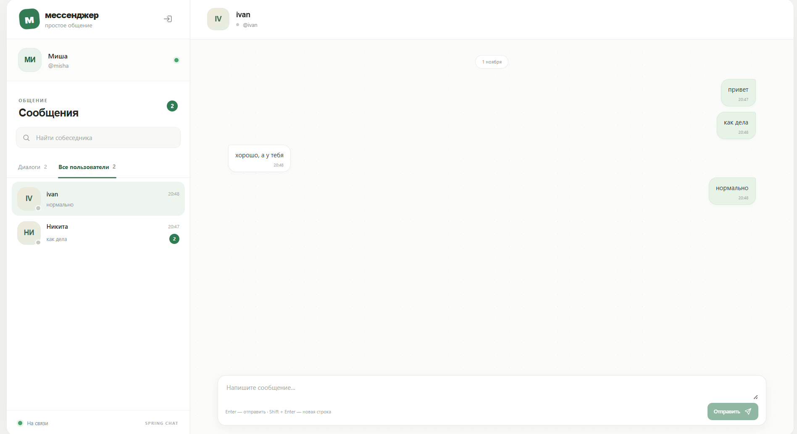

# Spring Messenger

Spring Messenger — веб-мессенджер для личной переписки в реальном времени. В приложении есть регистрация и вход, каталог пользователей, личные диалоги, история сообщений с пагинацией, отметка прочтения и статусы присутствия.



## Возможности

- Регистрация и вход по имени пользователя и паролю.
- Личные диалоги между пользователями и список последних диалогов.
- Отправка сообщений через REST API или WebSocket/STOMP.
- Получение новых сообщений в реальном времени и постраничная загрузка истории.
- Отметки прочтения и счётчики непрочитанных сообщений.
- Каталог и поиск пользователей, онлайн-статусы.
- JWT-аутентификация, проверка доступа к диалогам и ограничение частоты отправки сообщений.

## Стек технологий

### Backend

- Java 21, Spring Boot 4.
- Spring MVC для REST API, Spring WebSocket и STOMP для обмена сообщениями.
- Spring Security и JWT (JJWT) для аутентификации и авторизации.
- Spring Data JPA, Hibernate и PostgreSQL 16 для хранения пользователей, диалогов и сообщений.
- Flyway для версионирования и применения миграций схемы базы данных.
- Redis 7 для статусов присутствия, WebSocket-сессий и распределённого ограничения частоты отправки сообщений.
- Bean Validation для проверки входных данных; MapStruct и Lombok для преобразования DTO и сокращения шаблонного кода.
- springdoc-openapi для документации API.
- Maven; интеграционные тесты на JUnit и Testcontainers.

### Frontend

- React 19, TypeScript 6 и Vite 8.
- Axios для REST API.
- `@stomp/stompjs` и SockJS для WebSocket/STOMP.
- ESLint для проверки кода.
- Nginx для раздачи собранного SPA и поддержки маршрутизации на клиенте.

### Инфраструктура и CI

- Docker и Docker Compose: frontend, backend, PostgreSQL и Redis.
- GitHub Actions CI запускается при каждом `push` и `pull_request`.
- Frontend job устанавливает зависимости через `npm ci`, запускает ESLint и production build.
- Backend job использует Java 21 и Maven Wrapper, проверяет форматирование через Spotless и выполняет `mvnw verify` (сборка и тесты).

## Запуск через Docker Compose

Требуются Docker и Docker Compose. Из корня репозитория подготовьте файл окружения:

```powershell
Copy-Item .env.example .env
```

Перед запуском замените демонстрационные значения `POSTGRES_PASSWORD` и `REDIS_PASSWORD`, а также установите собственный Base64 JWT-ключ длиной не менее 32 байт в `APP_JWT_SECRET_BASE64`. Для локальной разработки в PowerShell можно создать ключ так:

```powershell
$bytes = New-Object byte[] 64
[Security.Cryptography.RandomNumberGenerator]::Create().GetBytes($bytes)
[Convert]::ToBase64String($bytes)
```

Скопируйте выведенное значение в `.env`, затем соберите и запустите все сервисы в фоне:

```powershell
docker compose up --build -d
```

После запуска:

| Сервис | Адрес |
|---|---|
| Приложение | http://localhost:5173 |
| REST API | http://localhost:8080 |
| Swagger UI | http://localhost:8080/swagger-ui.html |
| OpenAPI JSON | http://localhost:8080/v3/api-docs |

Порты можно переопределить в `.env` через `FRONTEND_PORT`, `BACKEND_PORT`, `POSTGRES_PORT` и `REDIS_PORT`. Данные PostgreSQL сохраняются в Docker volume `postgres_data`.

## Структура репозитория

```text
backend/       Spring Boot REST API, WebSocket/STOMP, бизнес-логика и интеграционные тесты
frontend/      React SPA, TypeScript и конфигурация Nginx
screenshots/   Скриншоты интерфейса
.github/       GitHub Actions CI
docker-compose.yml
.env.example
```

## Документация частей проекта

- [Backend: архитектура, конфигурация, REST API и WebSocket](backend/README.md)
- [Frontend: структура приложения и API-клиент](frontend/README.md)
